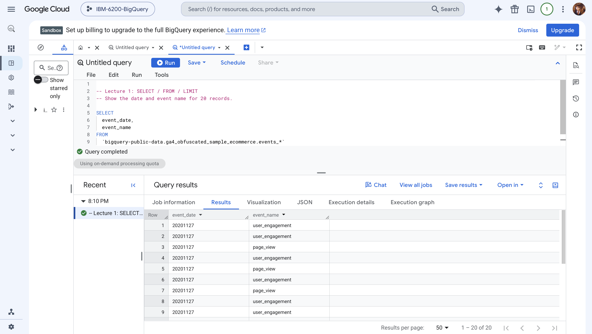
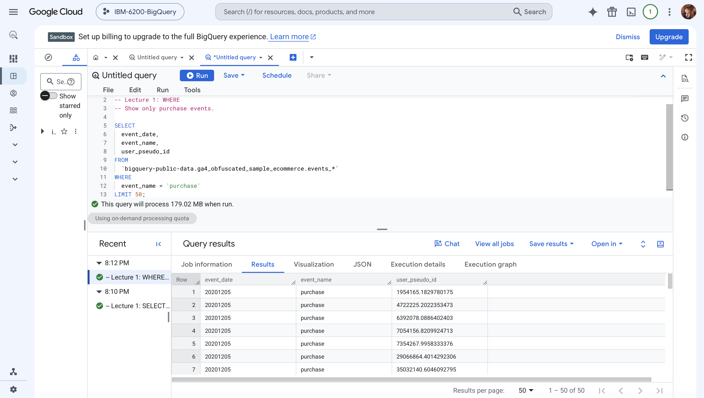
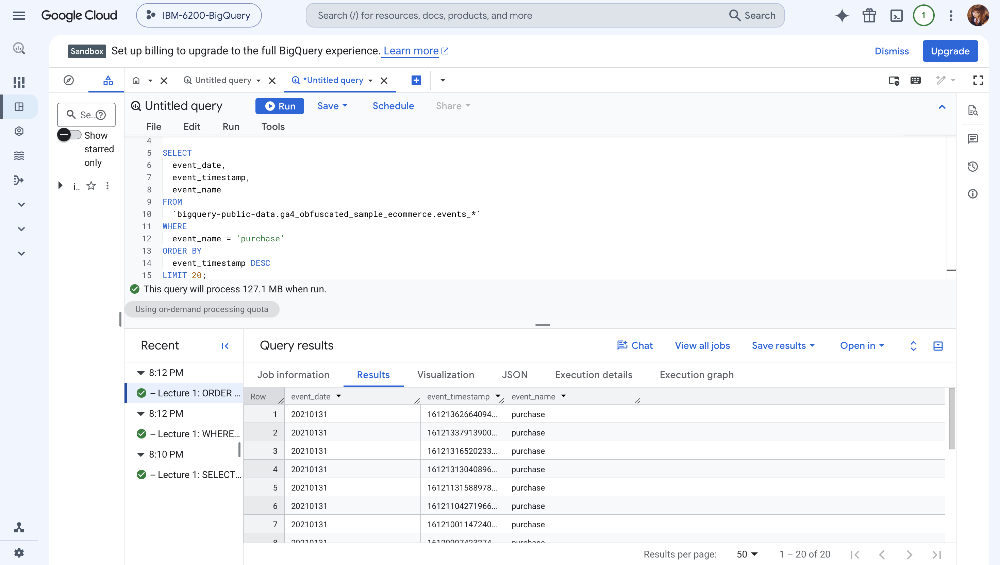
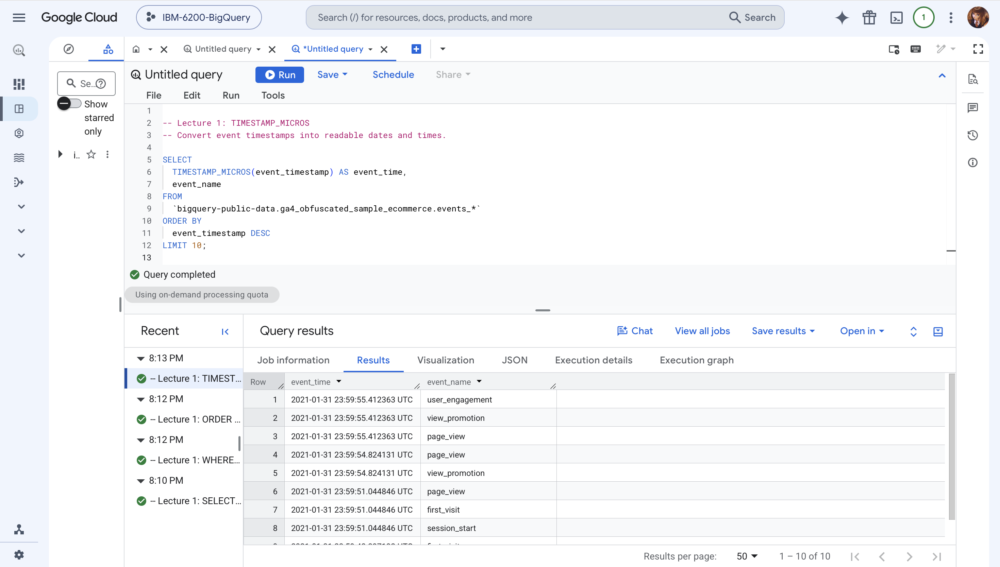
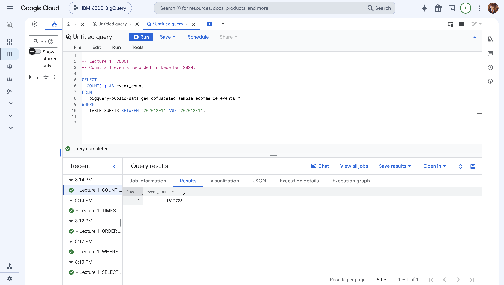
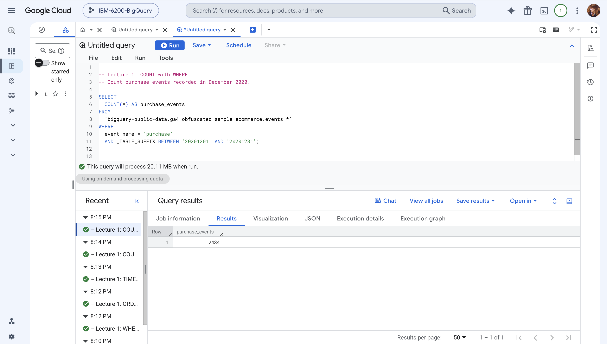
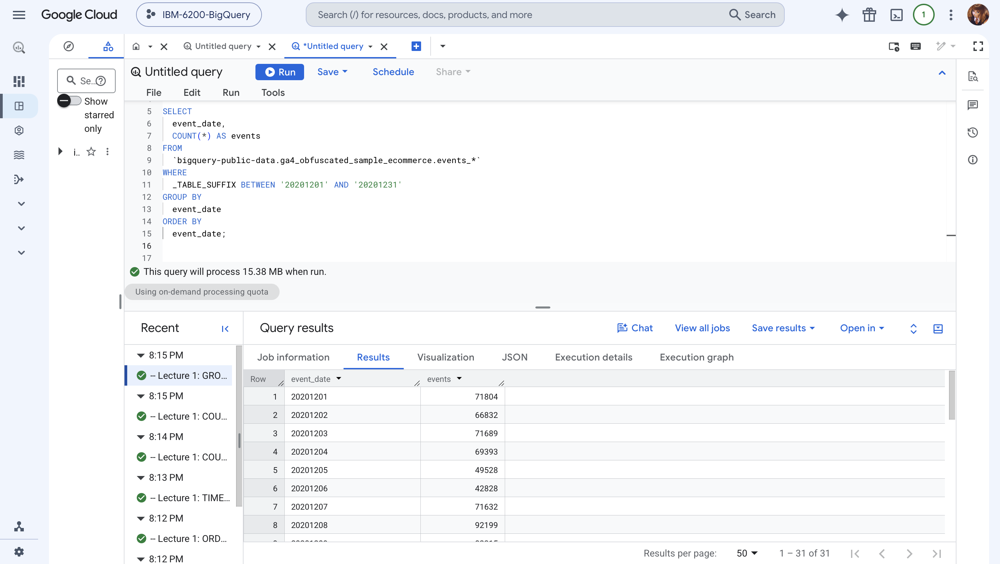
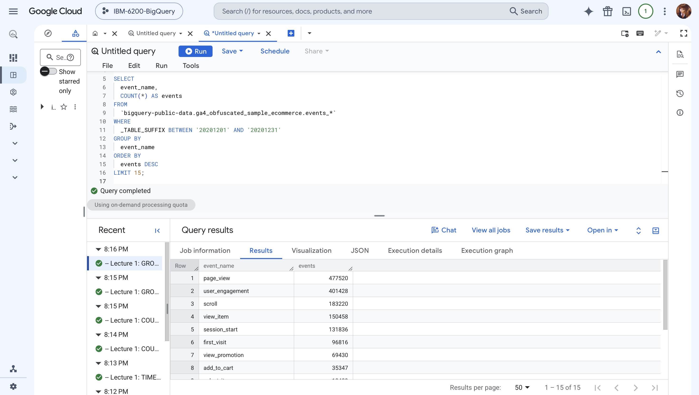
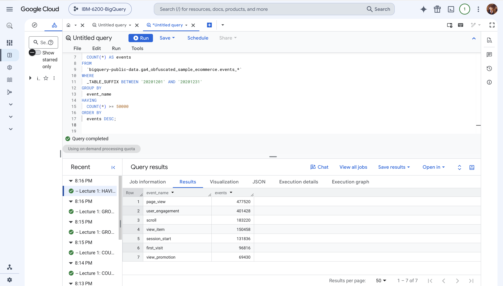
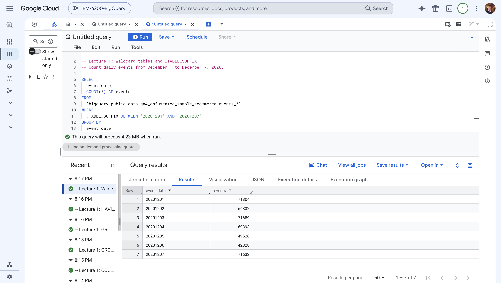

# 1. SELECT / FROM / LIMIT

## Query 1 — Select event records

``` sql
SELECT
  event_date,
  event_name
FROM
  `bigquery-public-data.ga4_obfuscated_sample_ecommerce.events_*`
LIMIT 20;
```

What the query does and what I found: This query selects the event date and event name and returns 20 rows. The results include `user_engagement` and `page_view`. Since there is no sorting condition, these are just 20 returned records, not necessarily the earliest or latest.

BigQuery result screenshot

{fig-alt="BigQuery SQL editor and result table for Query 1 — Select event records" width="100%"}

# 2. WHERE

## Query 2 — Purchase events

``` sql
SELECT
  event_date,
  event_name,
  user_pseudo_id
FROM
  `bigquery-public-data.ga4_obfuscated_sample_ecommerce.events_*`
WHERE
  event_name = 'purchase'
LIMIT 50;
```

What the query does and what I found: The `WHERE` condition keeps only events named `purchase`. All 50 returned rows show purchase events, along with their dates and pseudonymous user IDs.

BigQuery result screenshot

{fig-alt="BigQuery SQL editor and result table for Query 2 — Purchase events" width="100%"}

# 3. ORDER BY

## Query 3A — Sort purchases

``` sql
SELECT
  event_date,
  event_timestamp,
  event_name
FROM
  `bigquery-public-data.ga4_obfuscated_sample_ecommerce.events_*`
WHERE
  event_name = 'purchase'
ORDER BY
  event_timestamp DESC
LIMIT 20;
```

What the query does and what I found: This query sorts purchase events by timestamp, newest first, and returns 20 records. The most recent purchase events in the results occurred on January 31, 2021.

BigQuery result screenshot

{fig-alt="BigQuery SQL editor and result table for Query 3A — Sort purchases" width="100%"}

## Query 3B — Readable timestamps

``` sql
SELECT
  TIMESTAMP_MICROS(event_timestamp) AS event_time,
  event_name
FROM
  `bigquery-public-data.ga4_obfuscated_sample_ecommerce.events_*`
ORDER BY
  event_timestamp DESC
LIMIT 10;
```

What the query does and what I found: `TIMESTAMP_MICROS()` changes the microsecond timestamp into a readable date and time in UTC. The 10 newest event records include `user_engagement`, `view_promotion`, and `page_view` on January 31, 2021.

BigQuery result screenshot

{fig-alt="BigQuery SQL editor and result table for Query 3B — Readable timestamps" width="100%"}

# 4. COUNT / aggregation

## Query 4A — Count all December events

``` sql
SELECT
  COUNT(*) AS event_count
FROM
  `bigquery-public-data.ga4_obfuscated_sample_ecommerce.events_*`
WHERE
  _TABLE_SUFFIX BETWEEN '20201201' AND '20201231';
```

What the query does and what I found: `COUNT(*)` counts all recorded events in the December 2020 daily tables. BigQuery returned 1,612,725 events.

BigQuery result screenshot

{fig-alt="BigQuery SQL editor and result table for Query 4A — Count all December events" width="100%"}

## Query 4B — Count December purchases

``` sql
SELECT
  COUNT(*) AS purchase_events
FROM
  `bigquery-public-data.ga4_obfuscated_sample_ecommerce.events_*`
WHERE
  event_name = 'purchase'
  AND _TABLE_SUFFIX BETWEEN '20201201' AND '20201231';
```

What the query does and what I found: This query adds a purchase filter to the December date range. There were 2,434 purchase events, about 0.15% of all recorded events in the month. That percentage is a share of events, not a user conversion rate.

BigQuery result screenshot

{fig-alt="BigQuery SQL editor and result table for Query 4B — Count December purchases" width="100%"}

# 5. GROUP BY

## Query 5A — Events by day

``` sql
SELECT
  event_date,
  COUNT(*) AS events
FROM
  `bigquery-public-data.ga4_obfuscated_sample_ecommerce.events_*`
WHERE
  _TABLE_SUFFIX BETWEEN '20201201' AND '20201231'
GROUP BY
  event_date
ORDER BY
  event_date;
```

What the query does and what I found: Grouping by `event_date` gives one row for each day in December 2020 (31 rows). For example, December 8 had 92,199 events, compared with 49,528 on December 5.

BigQuery result screenshot

{fig-alt="BigQuery SQL editor and result table for Query 5A — Events by day" width="100%"}

## Query 5B — Top event types

``` sql
SELECT
  event_name,
  COUNT(*) AS events
FROM
  `bigquery-public-data.ga4_obfuscated_sample_ecommerce.events_*`
WHERE
  _TABLE_SUFFIX BETWEEN '20201201' AND '20201231'
GROUP BY
  event_name
ORDER BY
  events DESC
LIMIT 15;
```

What the query does and what I found: This query groups records by event type, counts them, and shows the 15 most frequent event types. `page_view` leads with 477,520 events, followed by `user_engagement` with 401,428.

BigQuery result screenshot

{fig-alt="BigQuery SQL editor and result table for Query 5B — Top event types" width="100%"}

# 6. HAVING

## Query 6 — Event types with 50,000+ events

``` sql
SELECT
  event_name,
  COUNT(*) AS events
FROM
  `bigquery-public-data.ga4_obfuscated_sample_ecommerce.events_*`
WHERE
  _TABLE_SUFFIX BETWEEN '20201201' AND '20201231'
GROUP BY
  event_name
HAVING
  COUNT(*) >= 50000
ORDER BY
  events DESC;
```

What the query does and what I found: `HAVING` filters the aggregated counts after `GROUP BY`. Seven event types occurred at least 50,000 times in December 2020. `page_view` was the highest at 477,520.

BigQuery result screenshot

{fig-alt="BigQuery SQL editor and result table for Query 6 — Event types with 50,000+ events" width="100%"}

# 7. Wildcard tables and \_TABLE_SUFFIX

## Query 7 — First week of December

``` sql
SELECT
  event_date,
  COUNT(*) AS events
FROM
  `bigquery-public-data.ga4_obfuscated_sample_ecommerce.events_*`
WHERE
  _TABLE_SUFFIX BETWEEN '20201201' AND '20201207'
GROUP BY
  event_date
ORDER BY
  event_date;
```

What the query does and what I found: The wildcard `events_*` refers to multiple daily tables, while `_TABLE_SUFFIX` narrows the scan to December 1–7, 2020. The result contains seven daily counts, including 71,804 on December 1 and 42,828 on December 6.

BigQuery result screenshot

{fig-alt="BigQuery SQL editor and result table for Query 7 — First week of December" width="100%"}

# Key takeaways

In this exercise, I practiced selecting columns, filtering records, sorting events, counting records, and grouping event data. `WHERE` filters individual records before aggregation, while `HAVING` filters groups after the counts are calculated. I also used `_TABLE_SUFFIX` to target the dates needed instead of querying every daily table. The results give a basic picture of event activity, but event counts alone do not tell us how many people converted.

# Project Links

- [View the notebook on GitHub Pages](https://sheilaaa0312.github.io/Luo-Xueying-lecture1-ga4/)
- [View the source files on GitHub](https://github.com/Sheilaaa0312/Luo-Xueying-lecture1-ga4)
